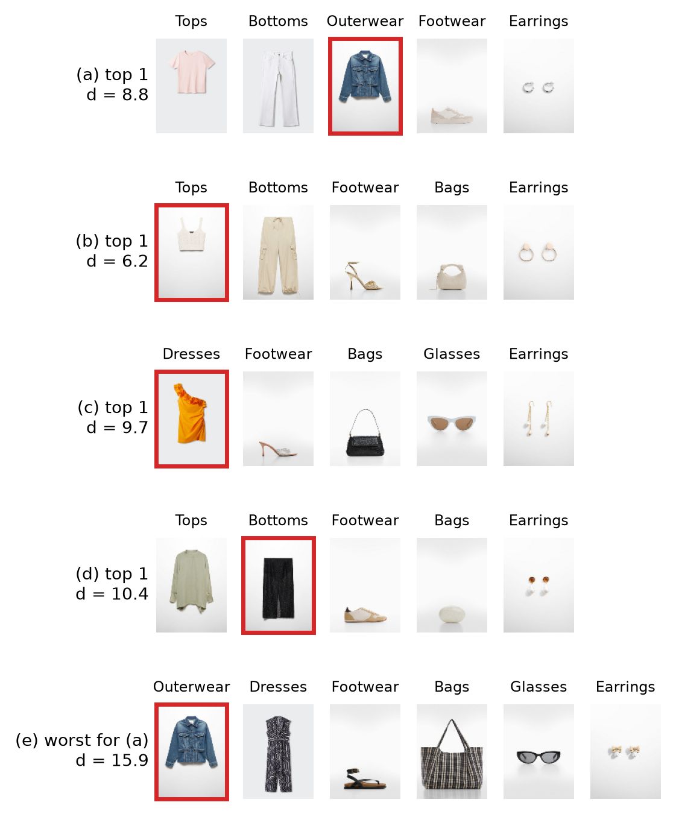

# Fashion compatibility with variational autoencoders

Does a variational autoencoder (VAE) trained on images of whole outfits learn
which products go together? A study in PyTorch on the MANGO data of the
[UPC Datathon 2023 fashion-compatibility challenge](https://github.com/Francesco7D2/datathon-2023-fashion-compatibility).



*Best-ranked candidate outfit for four input products (red frame), and the
worst-ranked one for (a). d is the distance to the nearest training outfit in
the latent space; lower ranks first.*

## Results

Fill-in-the-blank test: for each slot of a held-out outfit, pick the true
product among 4 options of the same class and catalogue (chance 25%).
Accuracy with 95% bootstrap intervals over outfits, for models trained on the
other 90% of outfits. Full table in
[reports/evaluation.csv](reports/evaluation.csv).

| Score | All questions (1,616) | Unseen product pairs (711) |
| --- | --- | --- |
| Product co-occurrence in training outfits | 57.3% (54.6–60.2) | 17.7% (16.7–18.5) |
| VAE latent distance | 44.1% (40.6–47.7) | 32.6% (28.9–36.3) |
| Colour coherence | 33.4% (31.5–35.1) | 32.2% (29.4–35.0) |
| Random | 24.2% (22.1–26.3) | 22.8% (19.7–26.1) |

"Unseen product pairs" are questions whose true product never appears in a
training outfit together with the outfit's other products.

- The VAE beats random, but loses to simple co-occurrence on products that
  have already been seen together.
- On unseen product pairs, co-occurrence falls below random. The VAE still
  beats random there, but does no better than a colour heuristic.
- The ranking mostly tracks how dark the products are: product darkness
  explains 48% of the variance of the distance, and the latent space
  separates the two photo catalogues perfectly, a difference of photo style
  rather than compatibility.

The [report](reports/report.pdf) has the full analysis, including the
reconstruction-only and foreground-weighted variants.

## How it works

1. Select 3,164 outfits by rules: a dress or a top and bottom, plus footwear
   and earrings, with up to five optional classes.
2. Turn each outfit into one 128 × 960 image with ten fixed product slots;
   empty slots are white.
3. Train a convolutional VAE with a 256-dimensional latent space (47.5M
   parameters; about 1.5 hours on an Apple M5 Pro GPU).
4. Generate candidate outfits from products never seen in training, and rank
   them by distance to the nearest training outfit.
5. Evaluate with the fill-in-the-blank test against simple baselines.

[docs/project-walkthrough.md](docs/project-walkthrough.md) covers the design,
the code map and the limitations.

## What I'd do next

1. Per-product embeddings from a pretrained image encoder instead of
   whole-outfit pixels, so that photo darkness and style matter less.
2. A ranker trained on fill-in-the-blank questions that combines
   co-occurrence, colour and visual similarity.
3. A distance normalised for outfit size and darkness.

All seven next steps are in [docs/usage.md](docs/usage.md#all-next-steps)
and the report.

## Run it

```bash
python3.12 -m venv .venv && source .venv/bin/activate
python -m pip install -r requirements.txt
python -m pytest -q              # synthetic data; no MANGO data or GPU needed
python -m scripts.pipeline all   # needs the MANGO data
```

The data and trained weights are not included.
[docs/usage.md](docs/usage.md) lists the files needed, every pipeline step and
option, devices, the evaluation runs and how to rebuild the report.

## History

Started after the UPC Datathon 2023 MANGO challenge. First version in
TensorFlow (March 2024); rewritten in PyTorch, with the fill-in-the-blank
evaluation and the report, using Claude Code (September–October 2026).

## Licence

Code under the [MIT licence](LICENSE). The MANGO data and images are not part
of this repository.
